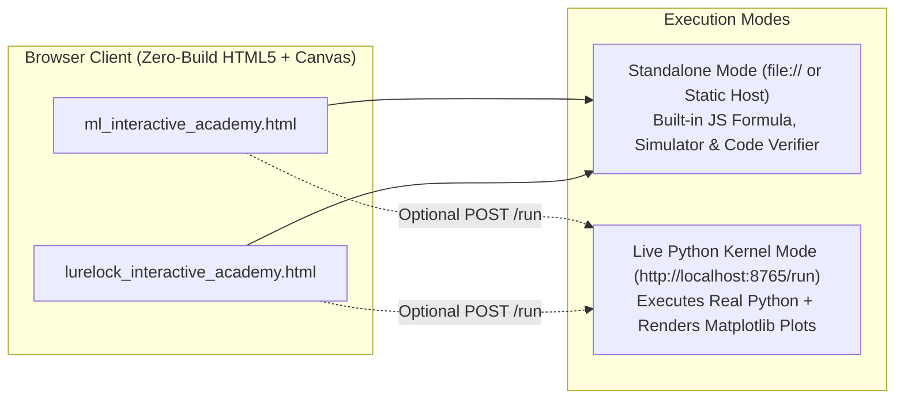

# Deployment & Operations Guide: Machine Learning & LureLock Interactive Academies

This guide covers all deployment options for both interactive academy applications:
1. **Machine Learning Zero-to-Mastery Academy** (`ml_interactive_academy.html`)
2. **LureLock Machine Learning & Data Cleaning Bible Academy** (`lurelock_interactive_academy.html`)

---

## 1. Package Contents

| File | Role |
| :--- | :--- |
| `ml_interactive_academy.html` | Self-contained single-file application: 18 curriculum modules, 4-paradigm taxonomy map, 15-equation formula dissector, 4 live Canvas simulators, 22+ Python library encyclopedia, 12 coding labs, 48 mastery quizzes, and 50-formula vault. |
| `lurelock_interactive_academy.html` | Self-contained single-file application: 14 cybersecurity ML curriculum modules, 10 dissected equations, 6 live calculators, 4 Canvas simulators (URL Forensic Scanner, XGBoost `booster[0]` Tree Tracer, 6-Stage Cleaning Funnel, 300-Tree Tug-of-War), 5-layer library encyclopedia, 10 coding challenges, and 36 mastery quizzes. |
| `ml_academy_server.py` | Unified Python HTTP server (`port 8765`) serving the Academy Hub portal (`/`) and providing a live `/run` execution kernel (`NumPy`, `Pandas`, `SciPy`, `Scikit-Learn`, `XGBoost`, and headless `Matplotlib` figure rendering). |
| `start_academy_server.bat` | One-click Windows launcher that starts `ml_academy_server.py` and opens `http://localhost:8765` in your browser. |
| `requirements.txt` | Python package list for the live execution backend. |
| `Dockerfile` | Container definition for deploying the full-stack Python execution hub to Docker, Render, Railway, Fly.io, or Google Cloud Run. |
| `DEPLOYMENT_GUIDE.md` | This deployment and troubleshooting reference. |

---

## 2. Deployment Architecture Overview



> [!NOTE]
> Both HTML files are **100% functional as standalone single-file web apps**. Every curriculum module, formula dissector, live calculator, HTML5 Canvas simulator, library reference, quiz, and offline code verifier works directly in the browser without requiring Python. Starting `ml_academy_server.py` upgrades the **Interactive Coding Lab (Tab 5)** to execute real Python code and render live `Matplotlib` PNG charts.

---

## 3. Option A: Instant Standalone Launch (No Server Required)

Use this option when sharing the HTML file via email, USB drive, LMS (Canvas/Blackboard/Moodle), or opening locally without Python:

1. Unzip the package to any folder on your computer.
2. Double-click `ml_interactive_academy.html` or `lurelock_interactive_academy.html` to open it in **Chrome**, **Edge**, **Brave**, or **Firefox**.
3. Use the top navigation bar to switch across all 7 tabs:
   - **Tab 1 (`Curriculum & Modules`)**: Click any module in the left sidebar (or click the topic pills in the 4-paradigm taxonomy map) to load its mathematical proofs, hand-worked numerical trace, and annotated Python walkthrough.
   - **Tab 2 (`Formula Dissector & Calculators`)**: Click individual symbols in any equation to inspect their meaning, and drag the calculator sliders for real-time numerical outputs.
   - **Tab 3 (`Interactive Simulators`)**: Interact with the HTML5 Canvas simulations.
   - **Tab 4 (`Library Encyclopedia`)**: Filter by ecosystem layer or search functions/parameters.
   - **Tab 5 (`Hands-On Coding Lab`)**: Write solutions and click **Run & Verify Code** (uses built-in static verification when offline).
   - **Tab 6 (`Mastery Quizzes`)**: Answer multiple-choice questions with instant mathematical explanations.
   - **Tab 7 (`Diagnostics & Formula Vault`)**: Troubleshoot production ML bugs and search the master equation tables.

---

## 4. Option B: Local Live Python 3.x Kernel Server (Recommended)

Use this option to enable live Python execution and `Matplotlib` figure rendering inside **Tab 5 (Coding Lab)**.

### Step 1: Install Python Dependencies
Open PowerShell or Command Prompt in the unzipped folder and run:

```powershell
pip install -r requirements.txt
```

### Step 2: Launch the Server
Either **double-click `start_academy_server.bat`** in Windows Explorer, or run:

```powershell
python ml_academy_server.py
```

### Step 3: Open in Browser
Navigate to any of the following URLs:
- **Unified Academy Hub Portal**: `http://localhost:8765/`
- **Machine Learning Zero-to-Mastery Academy**: `http://localhost:8765/ml_interactive_academy.html`
- **LureLock ML & Data Cleaning Academy**: `http://localhost:8765/lurelock_interactive_academy.html`
- **Health Check Endpoint**: `http://localhost:8765/health`

---

## 5. Option C: Static Cloud Hosting (GitHub Pages, Netlify, Vercel)

Because each academy is a self-contained `.html` file with zero build steps, you can deploy either or both to any static host in under 60 seconds:

### GitHub Pages
1. Create a new GitHub repository and upload `ml_interactive_academy.html` and `lurelock_interactive_academy.html` (optionally rename either to `index.html`).
2. Go to **Settings -> Pages -> Build and deployment**, select **Deploy from a branch (`main` / `root`)**, and click **Save**.
3. Your interactive academies will be live at `https://<your-username>.github.io/<repo-name>/ml_interactive_academy.html` and `https://<your-username>.github.io/<repo-name>/lurelock_interactive_academy.html`.

### Netlify Drop (Drag & Drop)
1. Go to [https://app.netlify.com/drop](https://app.netlify.com/drop).
2. Drag and drop the unzipped folder directly onto the page.
3. Netlify immediately publishes a public HTTPS URL serving both academies.

### Vercel CLI
```powershell
npx vercel --prod
```

---

## 6. Option D: Docker & Cloud Container Deployment (With Live Python Kernel)

To host the full Python execution kernel in the cloud (Render, Railway, Fly.io, Google Cloud Run, or self-hosted Docker):

### Build and Run Locally with Docker
```powershell
docker build -t ml-lurelock-academy .
docker run -d -p 8765:8765 --name academy-hub ml-lurelock-academy
```
Then open `http://localhost:8765/`.

> [!CAUTION]
> `ml_academy_server.py` executes arbitrary Python code submitted to `/run` using `exec()`. Run it on `127.0.0.1` (localhost) for personal study, or inside an isolated, resource-limited container if exposing to a trusted classroom network.

---

## 7. Troubleshooting & Verification

| Symptom | Cause | Fix |
| :--- | :--- | :--- |
| Browser shows an older cached layout after updating files | Browser cached a previous `file://` or `http://` view | Press `Ctrl + F5` (hard refresh) or open via `http://localhost:8765/` (which sends `Cache-Control: no-store`). |
| Port `8765` is already in use (`WinError 10048`) | A previous instance of `ml_academy_server.py` is already running | Open `http://localhost:8765/` directly—the server is already active! To restart it, run `Stop-Process -Id (Get-NetTCPConnection -LocalPort 8765).OwningProcess -Force` in PowerShell. |
| Coding Lab says `Offline static check` instead of `Live Python kernel` | `ml_academy_server.py` is not running | Run `start_academy_server.bat` or `python ml_academy_server.py`, then click **Run & Verify Code** again. |
