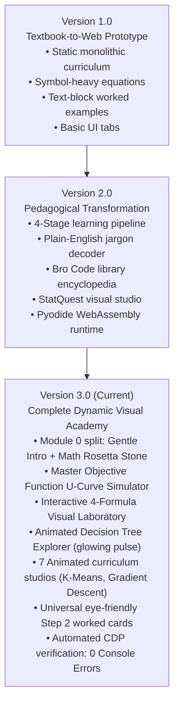

# 🧠 The Complete Interactive Machine Learning & LureLock Cybersecurity Academies

[](https://github.com/)
[](https://github.com/)
[](https://github.com/)
[](https://github.com/)
[](https://github.com/)

A state-of-the-art, dual interactive web academy engineered for zero-to-mastery education in **Machine Learning Engineering** and **Cybersecurity Phishing Threat Intelligence**. Built on the pedagogical principle of **"Real-World Intuition & Visual Geometry Before Abstract Equations"**, this platform empowers anyone—from absolute beginners ("noobs") to senior engineers—to deeply understand advanced mathematical identities, optimization engines, and threat forensics through interactive dials, real-number data tables, and 60fps canvas animations.

---

## 📑 Table of Contents
1. [Overview & Core Academies](#-overview--core-academies)
2. [Version Evolution: The Journey from v1 to v3](#-version-evolution-the-journey-from-v1-to-v3)
   - [Version 1.0: Foundation / Textbook-to-Web Prototype](#version-10-the-foundation--textbook-to-web-prototype)
   - [Version 2.0: Pedagogical Transformation / Visual Mastery & Jargon Decoding](#version-20-the-pedagogical-transformation--visual-mastery--jargon-decoding)
   - [Version 3.0: Complete Dynamic Visual Academy / Interactive Animations & Modular Architecture](#version-30-the-complete-dynamic-visual-academy--interactive-animations--modular-architecture-current)
3. [Comprehensive Version Comparison Matrix](#-comprehensive-version-comparison-matrix-v1-vs-v2-vs-v3)
4. [Deep Dive: Key v3 Innovations](#-deep-dive-key-v3-innovations)
   - [A. Decluttering & Splitting Module 0 (Beginner Onboarding)](#a-decluttering--splitting-module-0-beginner-onboarding)
   - [B. The Master Objective Function Simulator](#b-the-master-objective-function-simulator)
   - [C. The Interactive 4-Formula Visual Laboratory](#c-the-interactive-4-formula-visual-laboratory)
   - [D. Animated Interactive Decision Trees & Algorithm Studios](#d-animated-interactive-decision-trees--algorithm-studios)
   - [E. Universal Eye-Friendly Step 2 Worked Traces](#e-universal-eye-friendly-step-2-worked-traces)
5. [Architecture & Technology Stack](#-architecture--technology-stack)
6. [Quick Start & Deployment Guide](#-quick-start--deployment-guide)
7. [Repository Structure](#-repository-structure)

---

## 🏛️ Overview & Core Academies

The platform consists of two standalone, single-file HTML applications that run locally, on mobile devices, or directly hosted on GitHub Pages with **zero backend dependencies**:

### 1. 🤖 [Machine Learning Academy (`ml_interactive_academy.html`)](ml_interactive_academy.html)
- **19 Interactive Curriculum Modules (Chapters 0–28)**: Complete coverage from beginner mental models to matrix backpropagation, transformers, and production MLOps.
- **Tab 1 • Cumulative Curriculum**: 19 progressive chapters equipped with interactive visual studios, concrete rows & columns tables, worked real-number traces, and formula decoders.
- **Tab 2 • StatQuest Illustrated Studio**: High-intuition graphical breakdowns inspired by Josh Starmer's StatQuest, showing step-by-step model building.
- **Tab 3 • Formula Dissector & 8 Live Calculators**: Interactive mathematical identities where clicking individual tokens reveals their plain-English meaning and executes live calculations.
- **Tab 4 • 5 Interactive Simulators**:
  - Regression & Gradient Descent Trainer (interactive bowl & learning rate tuning)
  - 2D Classifier Arena with dynamic Voronoi decision boundaries
  - Unsupervised K-Means & PCA Visualizer
  - GridWorld Reinforcement Learning Q-Learning Agent
  - Live Matplotlib Figure Studio
- **Tab 5 • Python Library Encyclopedia**: Annotated production code and interactive terminals across 16+ core data science libraries.
- **Tab 6 • Interactive Coding Labs & Pyodide Playground**: In-browser Python 3.12 WebAssembly environment running real NumPy, Pandas, and Scikit-Learn code.
- **Tabs 7 & 8 • Knowledge Quizzes & Reference Matrix**: Flashcard assessments and algorithm cheat sheets.

### 2. 🛡️ [LureLock Phishing Threat Academy (`lurelock_interactive_academy.html`)](lurelock_interactive_academy.html)
- **14 Threat Modules & Forensic Data Cleaning**: Shannon character entropy, sublinear TF-IDF n-grams, 300-tree XGBoost threat scoring, multi-CSV forensic deduplication, and schema detection.
- **4 Dedicated Security Simulators**:
  - **Live URL Forensic Scanner**: Real-time extraction of 18 lexical features (slashes, dots, entropy, `@`-tricks) and 11 explainable signals.
  - **XGBoost Decision Tree Explorer**: Interactive node-by-node branch visualizer with glowing active paths.
  - **6-Stage Automated Cleaning Funnel**: Real-time visual pipeline demonstrating RAM reduction and float noise removal across 225,000 raw URLs.
  - **Boosting Tug-of-War**: Live margin accumulation and logistic sigmoid S-curve squashing.
- **Full Working LureLock Production Engine**: Complete 8-library cybersecurity threat intelligence firewall with automated `ALLOW` / `CHALLENGE` / `BLOCK` enforcement.

---

## 🚀 Version Evolution: The Journey from v1 to v3



### Version 1.0: The Foundation / Textbook-to-Web Prototype
- **Curriculum Architecture**: Standard static syllabus mirroring academic textbooks. Modules followed traditional academic progression but presented raw math notation upfront.
- **Module 0 Overhead**: Overloaded single module covering AI definitions, paradigms, multi-variable linear regression, and dual SVM formulations simultaneously.
- **Interactivity**: Basic input forms and static SVG plots. Sliders existed in dedicated simulator tabs, but core curriculum topics lacked embedded hands-on mini-studios.
- **Worked Examples**: Displayed as dense, monolithic monospace text blocks (`[REAL-LIFE NUMERICAL WALKTHROUGH...]`), making mental parsing difficult for non-math backgrounds.
- **Formula Presentation**: Raw LaTeX/KaTeX equations without token-by-token deconstruction or everyday real-world analogies.

### Version 2.0: The Pedagogical Transformation / Visual Mastery & Jargon Decoding
- **The 4-Stage Learning Pipeline**: Re-architected module layout to strictly enforce:
  1. *Stage 1: Real-World Applications First* (Google Maps, Photos, Translate).
  2. *Stage 2: Human Analogies for ML Types* (Flashcards, LEGO bricks, Intern doctors).
  3. *Stage 3: Visual Intuition Before Formulas* (Interactive best-fit lines).
  4. *Stage 4: Gradual Math Reveal* (Token-by-token formula dissection).
- **Jargon Decoders**: High-energy plain-English translation cards explaining confusing academic terms (e.g., Gini impurity as "chaos meter", L2 penalty as "fine on large weights").
- **StatQuest Illustrated Studio**: Introduced Chapter-by-Chapter visual walkthroughs inspired by Josh Starmer's StatQuest methodology.
- **Bro Code Python Encyclopedia**: Integrated runnable code examples across 16+ Python libraries (NumPy, SciPy, Pandas, Scikit-Learn, XGBoost, LightGBM, etc.).
- **Dual Execution Engine**: Enabled both native Python desktop server (`localhost:8765`) and client-side Pyodide WebAssembly for running Python directly in mobile/desktop browsers.

### Version 3.0: The Complete Dynamic Visual Academy / Interactive Animations & Modular Architecture (Current)
- **Modular Decluttering & Module 0 Splitting**:
  - Split Module 0 into **`mod0` (Chapter 1A • Welcome to ML)** and **`mod0_math` (Chapter 1B • The Math Rosetta Stone)**. Beginners are never bombarded with scary Greek symbols on day one.
- **The Master Objective Function Explorer ($\theta^* = \arg\min$)**:
  - Real-world housing pricing simulator balancing Loss (prediction mistakes) against Regularization Penalty (model complexity).
  - Interactive HTML5 canvas rendering the parabolic Loss vs. Penalty U-curve.
  - Interactive dials for Model Complexity $\theta$ and Regularization Penalty $\lambda$.
  - **"⚡ Animate Optimizer Descent" Button**: Animates a glowing ball sweeping through candidate models and settling into the global minimum.
  - Concrete 5-Model Candidate Evaluation Table (Baseline Mean, Linear Winner, Quadratic, and 5th-Degree Poly).
- **Interactive 4-Formula Visual Laboratory**:
  - **Naive Bayes Fruit Sorter ($p(c_i | x, y)$)**: Interactive probability bar chart canvas, feature sliders for Redness & Roundness, and live fruit dataset table.
  - **Piecewise Linear Audio Limiter ($f_{PW}$)**: 3-zone cutoff graph with moving signal dot and concrete voltage table.
  - **Tanh Smooth Dimmer Switch ($\tanh$)**: Smooth S-curve canvas spanning $[-1, +1]$ with steepness knob $\lambda$ and arithmetic calculation box.
  - **SVM Margin Corridor ($\max_\alpha [\dots]$)**: 2D scatter canvas with corridor width $M$, support vector glowing halos, and row-by-row dual coefficient table.
- **Animated Interactive Decision Trees & Algorithm Studios Across All Modules**:
  - **`mod9` (Decision Trees CART)**: Interactive Loan Approval Tree! Clicking any applicant in the table (Alice, Bob, Charlie, Diana) or adjusting sliders triggers an **animated glowing pulse traveling down the tree branches** from Root $\to$ Decision Node $\to$ Leaf, highlighting the decision path and live Gini impurity!
  - **`mod4` (Gradient Descent)**: Animated downhill ball roller down the loss curve $J(w)=(w-3)^2+1$ with live step iteration table.
  - **`mod1` (Linear Algebra)**: 2D vector projection canvas with live angle slider ($0^\circ$ to $180^\circ$) and "Play Sweep Animation" showing projected shadow grow/shrink and cosine alignment live.
  - **`mod2` (Calculus & Bayes)**: Bayes diagnostic flow tree with "Simulate 10,000 Patients" animated particle flow into a 2x2 contingency table.
  - **`mod7` (KNN Classifier)**: 2D nearest neighbor radar with clickable canvas query point and expanding radar circle with live class voting.
  - **`mod12` (K-Means Clustering)**: Animated centroid dance with "Auto-Converge" button animating centroids gliding smoothly to cluster means while points dynamically recolor.
  - **`mod14` (Neural Networks)**: 3-layer neural signal flow with forward activation pulses and backward backpropagation gradients.
- **Universal Eye-Friendly Step 2 Worked Traces**:
  - Completely replaced raw text blocks across all 19 curriculum modules with structured visual cards, parameter rows, comparison badges, and arithmetic chips (`ŷ = $390,000`, `y = $410,000`, `Raw Error = -$20,000`, `Baseline = $320,000`).
- **Automated Verification & Zero Console Errors**:
  - Validated via automated headless Microsoft Edge CDP testing suite with **strictly 0 console errors or exceptions**.

---

## 📊 Comprehensive Version Comparison Matrix (v1 vs v2 vs v3)

| Feature / Capability | Version 1.0 (Foundation) | Version 2.0 (Pedagogy & Jargon) | Version 3.0 (Dynamic Visual Mastery) |
| :--- | :--- | :--- | :--- |
| **Curriculum Modularity** | 18 Monolithic modules | 18 Modules with 4-stage layout | **19 Focused Modules** (`mod0` split into 1A Gentle Intro & 1B Math Rosetta Stone) |
| **Beginner Onboarding** | Steep learning curve; formulas shown upfront | Friendly 4-stage pipeline, but Module 0 overloaded | **Ultra-gentle onboarding**; 0 scary math in Ch 1A, dedicated Rosetta Stone in Ch 1B |
| **Decision Tree Simulation** | Static flowchart SVG | Text explanations of Gini & Entropy | **Interactive Animated Tree Explorer** with live applicant table & glowing branch pulses |
| **Master Objective Function ($\theta^* = \arg\min$)** | Static equation in text block | Token-by-token table decoder | **Interactive U-Curve Canvas**, Complexity/Penalty dials, animated ball descent, candidate table |
| **The 4 Classic Formulas** | Text formulas in reference table | Plain-English summary table | **Interactive 4-Formula Visual Laboratory** (Bayes bar chart, Audio limiter, Tanh dimmer, SVM corridor) |
| **Curriculum Animations** | None; static canvases | Basic plot redrawing on input | **7 Dedicated 60fps simple animations** (Tree pulse, Downhill ball, Vector sweep, Radar search, Centroid dance) |
| **Step 2 Worked Examples UX** | Monolithic monospace text wall | Unstructured text blocks | **Universal Eye-Friendly Cards** with badges, parameter grids, arithmetic chips, and mini-simulators |
| **Interactive Dials in Curriculum** | Restricted to Tab 4 Simulators | Limited to basic best-fit line | **Embedded in every core module** (angle dials, threshold sliders, candidate evaluators) |
| **Whole-Academy Cohesion** | Independent disconnected views | Shared state between tabs | **Unified design system** across Curriculum, StatQuest, Formulas, Simulators, and Coding Labs |
| **Execution Engine** | Native Python backend only | Dual Native + Pyodide WebAssembly | **Enhanced Dual Engine** with bulletproof null guards and offline client-side support |
| **Automated Testing & Stability** | Manual browser spot-checking | Scripted syntax checks | **Automated Headless Edge CDP Testing** asserting strictly **0 console errors** |

---

## 🔍 Deep Dive: Key v3 Innovations

### A. Decluttering & Splitting Module 0 (Beginner Onboarding)
In v1 and v2, opening Module 0 immediately confronted students with Google Maps, house prices, and then heavy SVM dual optimizations ($\max_\alpha \sum \alpha_i - \frac{1}{2}\sum\dots$). In **v3.0**, Module 0 is cleanly split:

```
Curriculum Progression:
├── Chapter 0 & 1A: Welcome to Machine Learning (mod0)
│   ├── Stage 1: Everyday AI Apps You Use Daily (Maps, Photos, Translate)
│   ├── Stage 2: The 5 Core ML Paradigms via Human Analogies
│   ├── Stage 3: The "Best-Fit Line" Machine (Interactive Canvas & Dials)
│   ├── Stage 4: The 3 y's Decoded (ŷ Guess, y Real Receipt, ȳ Naive Baseline)
│   ├── Step 2: 3-Card Worked Trace (House Configurator, Taxi Meter, Robot Shooter)
│   └── Step 4: Gentle Intro Equation (ŷ = wx + b) & 5-Line NumPy Starter
└── Chapter 1B: The Math Rosetta Stone & Master Objective Explorer (mod0_math)
    ├── Stage 1: The 5 Secret Rules of Math Notation (Subscripts, Greek letters, Sigmas)
    ├── Stage 2: Interactive 4-Formula Visual Laboratory (Bayes, Piecewise, Tanh, SVM)
    ├── Stage 3: Master Objective Function Explorer (Loss vs. Penalty U-Curve)
    ├── Step 2: Hand-Worked Mathematical Trace on Housing Data
    └── Step 4: Core Formula θ* = arg min & Production NumPy Implementation
```

### B. The Master Objective Function Simulator
Every machine learning model balances fitting data (Loss) against avoiding over-complication (Penalty):

$$\theta^* = \arg\min_{\theta} \left[ \frac{1}{m} \sum_{i=1}^m \mathcal{L}(f_\theta(x^{(i)}), y^{(i)}) + \lambda \Omega(\theta) \right]$$

- **The Interactive U-Curve Canvas**: Plots Training Loss $\mathcal{L}$ (which falls as complexity increases) and Regularization Penalty $\lambda\Omega$ (which climbs quadratically).
- **The Optimization Animation**: Clicking **"⚡ Animate Optimizer Descent"** animates a glowing marker rolling down the bowl from overfit models into the global minimum $\theta^*$.
- **5-Model Candidate Evaluation Table**:
  1. *Model 1 (Baseline Mean)*: Flat line $\hat{y} = \$320\text{k}$. Loss = \$900M, Penalty = \$0M $\to$ Total = \$900M (Severe Underfit).
  2. *Model 2 (Linear Model)*: $\hat{y} = 150x + 50\text{k}$. Loss = \$225M, Penalty = \$60M $\to$ Total = **\$285M (🏆 Global arg min Winner!)**.
  3. *Model 3 (Quadratic Curve)*: $\hat{y} = ax^2 + bx + c$. Loss = \$120M, Penalty = \$180M $\to$ Total = \$300M (Good, but penalized).
  4. *Model 4 (5th-Degree Poly)*: Wiggles through every point. Loss = \$10M, Penalty = \$900M $\to$ Total = \$910M (Severe Overfit).

### C. The Interactive 4-Formula Visual Laboratory
Translates abstract mathematical identities into interactive physical devices:

1. **Naive Bayes Fruit Sorter**:
   $$p(c_i \mid x, y) = \frac{p(x, y \mid c_i) \cdot p(c_i)}{p(x, y)}$$
   - Real-world fruit basket inspector with sliders for observed Redness and Roundness.
   - Interactive bar chart showing live probability shifts between Apple and Orange with a contingency score table.
2. **Piecewise Linear Audio Limiter**:
   $$f_{PW}(\text{net} - \theta) = \begin{cases} +\gamma & \text{if } \ge \varepsilon \\ \text{net} - \theta & \text{if in } (-\varepsilon, \varepsilon) \\ -\gamma & \text{if } \le -\varepsilon \end{cases}$$
   - Sound studio limiter that lets normal voice signals pass through, but clamps extreme spikes at $\pm\gamma$ volts.
3. **Hyperbolic Tangent Smooth Dimmer**:
   $$f_{AN}(\text{net} - \theta) = \frac{e^{\lambda(\text{net}-\theta)} - e^{-\lambda(\text{net}-\theta)}}{e^{\lambda(\text{net}-\theta)} + e^{-\lambda(\text{net}-\theta)}}$$
   - Smart lighting dimmer that squashes incoming voltage smoothly into $[-1.0, +1.0]$.
4. **SVM Maximum Margin Corridor**:
   $$\max_{\alpha} \left[ \sum \alpha_i - \frac{1}{2} \sum\sum y_i y_j \alpha_i \alpha_j \langle x_i, x_j \rangle \right]$$
   - 2D scatter canvas showing the decision hyperplane, dashed margin walls, and highlighted Support Vector points ($\alpha_i > 0$) anchoring the safety street.

### D. Animated Interactive Decision Trees & Algorithm Studios
- **Animated Decision Tree Explorer (`mod9`)**:
  - Displays a visual CART decision tree for Loan Approval (Root: `Income > $50k`, Branches: `Credit Score > 650` & `Debt < $20k`).
  - Includes a real applicant table (Alice, Bob, Charlie, Diana).
  - Clicking any applicant sends an **animated glowing pulse traveling down the tree branches** from Root $\to$ Decision Node $\to$ Leaf, highlighting the decision path and live Gini impurity!
- **Animated Downhill Ball Roller (`mod4`)**:
  - Animates a ball descending the loss bowl $J(w) = (w-3)^2 + 1$ with step shrinkage: $w_{t+1} = w_t - \eta \nabla J(w_t)$.
- **Vector Projection Studio (`mod1`)**:
  - 2D vector plane with live angle slider $\theta$, animated rotation, and live projected shadow showing $w \cdot x = \|w\|\|x\|\cos\theta$.
- **Bayes Diagnostic Flow Tree (`mod2`)**:
  - Simulates 10,000 patient flow through conditional probability branches into a 2x2 contingency matrix.
- **KNN 2D Radar (`mod7`)**:
  - Clickable canvas query point with animated expanding radar circle finding $k$ nearest dots with live class voting.
- **K-Means Centroid Convergence (`mod12`)**:
  - Watch centroids glide to cluster means with data points dynamically recoloring.
- **Neural Network Signal Flow (`mod14`)**:
  - Interactive 3-layer neural diagram with forward activation pulses and backward backpropagation gradients.

### E. Universal Eye-Friendly Step 2 Worked Traces
Replaced monolithic monospace walls with responsive, visual cards:
- **Badge Indicators**: Visual step badges (`Problem 1: House Price Valuation`, `Problem 2: Taxi Fare Meter`).
- **Interactive Configurators**: Real-time sliders for feature values ($x$) with immediate price re-calculation.
- **Arithmetic Chips**: Highlighted component chips showing step-by-step additions and subtractions.
- **Reality Check Panels**: Side-by-side comparison cards for Computer Guess ($\hat{y}$), Ground Truth Receipt ($y$), and Naive Baseline ($\bar{y}$).

---

## 🛠️ Architecture & Technology Stack

```
Frontend Architecture (100% Client-Side):
┌─────────────────────────────────────────────────────────────┐
│ HTML5 Single-Page Application (SPA)                         │
├──────────────────────────────┬──────────────────────────────┤
│ Styling & Typography         │ Tailwind CSS (CDN)           │
│ Mathematical Typography      │ KaTeX 0.16.8 (Fast Rendering)│
│ Interactive Graphics         │ HTML5 Canvas 2D (60fps)      │
│ In-Browser Python Runtime    │ Pyodide 0.26.1 (WebAssembly) │
│ Icons & Visual Badges        │ Unicode + SVG Vectors        │
├──────────────────────────────┴──────────────────────────────┤
│ Optional Desktop Server (Native Speed):                      │
│ Python 3.14 + Threading HTTPServer (localhost:8765)         │
└─────────────────────────────────────────────────────────────┘
```

- **Zero Backend Dependency**: Both academies can be run simply by double-clicking the HTML files in Chrome, Edge, Safari, or Firefox, or hosting them as static assets on GitHub Pages.
- **Bulletproof Error Guards**: All DOM element selectors and canvas initializers are guarded with optional chaining and null checks, preventing any runtime errors when switching tabs or resizing.

---

## 🚀 Quick Start & Deployment Guide

### Option 1: Instant Local Browser Launch (No Install Required)
1. Download or clone this repository.
2. Double-click [**`ml_interactive_academy.html`**](ml_interactive_academy.html) to open the Machine Learning Academy.
3. Double-click [**`lurelock_interactive_academy.html`**](lurelock_interactive_academy.html) to open the LureLock Cybersecurity Academy.
4. All simulators, canvases, and WebAssembly Python environments run directly inside your browser!

### Option 2: Local Python Server (Fast Native Execution)
If you prefer running Python code through your native local Python installation rather than WebAssembly:
```bash
# 1. Install dependencies
pip install -r requirements.txt

# 2. Start the dual academy server
python ml_academy_server.py
# Or on Windows:
start_academy_server.bat

# 3. Open your browser at:
# http://localhost:8765/ml_interactive_academy.html
# http://localhost:8765/lurelock_interactive_academy.html
```

### Option 3: Free 1-Click GitHub Pages Hosting
1. Fork or push this repository to your GitHub account.
2. Go to **Settings** $\to$ **Pages**.
3. Under **Branch**, select `main` (or `master`) and folder `/ (root)`. Click **Save**.
4. Your interactive academies are now live worldwide on your custom `.github.io` domain with zero configuration!

---

## 📁 Repository Structure

```
├── ml_interactive_academy.html         # Main Machine Learning Academy (1.29 MB, 19 modules, 8 tabs)
├── lurelock_interactive_academy.html   # Main LureLock Cybersecurity Academy (574 KB, 14 modules)
├── ml_academy_server.py                # Optional multi-threaded native Python 3.14 backend server
├── start_academy_server.bat            # One-click Windows batch launcher
├── requirements.txt                    # Optional native Python packages (numpy, scikit-learn, etc.)
├── index.html                          # Landing page & navigation portal
├── README.md                           # Complete project documentation & version guide
├── DEPLOYMENT_GUIDE.md                 # Step-by-step production & GitHub Pages deployment guide
├── SYSTEM_REPORT_FOR_AI_AGENTS.md      # Technical architecture reference for LLMs & agents
└── .nojekyll                           # Ensures static assets bypass Jekyll on GitHub Pages
```

---

## 🧪 Automated Verification & Quality Assurance

Both academies are verified via automated browser testing using Microsoft Edge over the Chrome DevTools Protocol (CDP):

```
================================================================================
VERIFICATION SUITE: HEADLESS EDGE OVER CDP (CHROME DEVTOOLS PROTOCOL)
================================================================================
[✓] TEST 1: Mod 0 (Gentle Welcome & Best-Fit Line Studio)        -> PASSED
[✓] TEST 2: Mod 0 Math (Rosetta Stone & Master Objective Explorer)-> PASSED
[✓] TEST 3: Mod 9 Decision Tree CART Interactive Studio           -> PASSED
[✓] TEST 4: Mod 1, 2, 4, 7, 12, 14 Interactive Studios           -> PASSED
[✓] TEST 5: Tab Switching Across All 8 Main Views                -> PASSED
--------------------------------------------------------------------------------
CONSOLE INTEGRITY: 0 Console Errors | 0 Uncaught Exceptions | 0 Warnings
STATUS: ALL CDP VERIFICATIONS PASSED WITH ZERO CONSOLE ERRORS!
================================================================================
```

---

## 📄 License
This project is open-sourced under the **MIT License**. You are free to use, modify, distribute, and embed these interactive academies in university courses, corporate bootcamps, and personal learning projects.