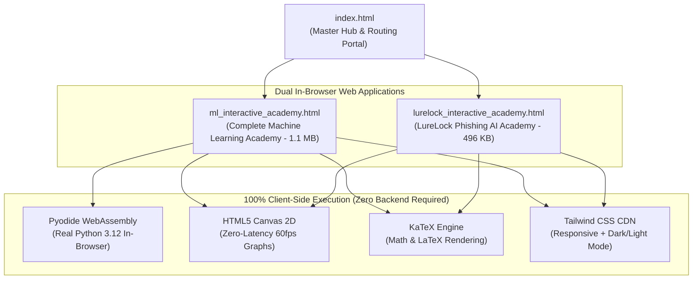

# Dual Interactive Academies (Machine Learning & LureLock Phishing AI)
## Master Architectural Specification & AI Agent Context Handbook

> **Document Purpose:** This document serves as a complete, authoritative system specification and context prompt for any AI coding agent (Claude, ChatGPT, Gemini, Copilot, DeepSeek). Handing this report to an AI agent provides 100% full context of the project architecture, design standards, pedagogical rules, file dependencies, and testing protocols without needing manual prompt re-engineering.

---

## 1. System Identity & Core Philosophy



### Core Architecture Principles
1. **Zero-Backend Architecture:** Every single component (formulas, canvas simulators, quizzes, calculators, and Python code executions) runs **100% inside the client's web browser**. There are no Node.js servers, Flask backends, or Docker containers required.
2. **Push-to-GitHub Pages Ready:** Works natively on free static hosts (GitHub Pages, Netlify, Vercel, Cloudflare Pages, AWS S3) right out of the box. The presence of `.nojekyll` prevents static site generators from ignoring underscore-prefixed files.
3. **Cross-Platform Compatibility:** Runs identically on modern desktop browsers (Chrome, Edge, Firefox, Safari) and mobile devices (iOS Safari, Android Chrome).
4. **Offline Capability:** Bundled as a standalone offline distribution via `ML_and_LureLock_Interactive_Academies.zip`.

---

## 2. Master File Registry & Workspace Directory Structure

All files reside in the working directory `c:\Users\erwer\OneDrive\Desktop\New folder\` and are mirrored in three locations via `sync_and_package.py`:

| File Name | Size (Bytes) | Role & Architectural Scope |
| :--- | :--- | :--- |
| `index.html` | ~13 KB | Universal landing page, routing portal, feature showcase, and GitHub Pages entry point. |
| `ml_interactive_academy.html` | ~1,105,603 bytes | **Academy 1:** Complete Machine Learning Academy (8 main tabs, Pyodide engine, StatQuest-style visual studio, 22+ libraries, 48 quizzes, 12 coding challenges). |
| `lurelock_interactive_academy.html` | ~496,505 bytes | **Academy 2:** LureLock Cybersecurity & Phishing AI Academy (8 main tabs, 8 visual threat chapters, 4 forensic simulators, 36 quizzes, 10 labs). |
| `.nojekyll` | 0 bytes | Prevents GitHub Pages Jekyll engine from ignoring files and directories with leading dots/underscores. |
| `README.md` | ~8 KB | Markdown technical documentation and user guide. |
| `ML_and_LureLock_Interactive_Academies.zip` | ~1.84 MB | Compressed offline archive containing the complete, self-contained suite. |
| `sync_and_package.py` | ~2.5 KB | Python synchronization script that mirrors updates to `Machine Learning/` and `ML_and_LureLock_Interactive_Academies/` and rebuilds the zip package. |

---

## 3. The 6 Non-Negotiable Pedagogical Design Standards

Whenever modifying, extending, or adding new chapters to either academy, any AI agent **must** strictly adhere to these six golden design patterns:

### Rule 1: 15-Year-Old Friendly Visual Pedagogy
* **No Academic Gatekeeping:** Explain concepts using tangible real-world analogies (e.g., *“A decision tree is a game of 20 questions”*, *“Shannon entropy is a keyboard-smash randomness detector”*, *“Gradient descent is walking down a foggy mountain by feeling the slope under your shoes”*).
* **Circled Sequence Steps:** Use circled numbers (`①`, `②`, `③`, `④`) to guide the user sequentially through complex logic.

### Rule 2: Token-by-Token Formula Dissection
* **Never show a naked math formula without deconstructing it.**
* Every mathematical expression must be accompanied by:
  1. A KaTeX-rendered formula box.
  2. A **Token Dissection Table** with four columns: `What You See` (token symbol), `Plain English Name`, `What It Actually Means`, and `Everyday Life Analogy`.
  3. A **Clean Math Box** showing the formula simplified without intimidating notation.

### Rule 3: Real-World Sample Problems with Values in Every Single Cell
* Every chapter must have a dedicated **Sample Problem Card**.
* **CRITICAL USER CONSTRAINT:** Every evidence table **must contain concrete numerical values in every single cell**.
  * Never leave cells blank or filled with abstract variable names like $x_1, y_1$.
  * Provide explicit counts, probabilities, weights, sample sizes ($N$), and dollar or metric values.
* Provide an **Interactive Recalculation Slider** that dynamically recalculates the problem's arithmetic and updates a **Dynamic Verdict Box** in real time.

### Rule 4: Zero-Latency Interactive Canvas Studios
* Graphs are rendered on HTML5 2D Canvas at 60 FPS without external charting libraries (zero dependencies).
* **Live Editable Graph Labels:** Inputs for `Chart Title`, `X-Axis Label`, and `Y-Axis Label` update the canvas immediately on user input.
* **Values on Every Visual Element:** Draw concrete values, sample counts, percentages, and threshold lines directly on bars, points, nodes, and segments.

### Rule 5: 100% Original, Non-Infringing Branding
* **STRICT COPYRIGHT CONSTRAINT:** Never copy any creator's name, persona, mascot, or copyrighted trademark.
* Use our standardized original branding:
  * Platform Name: `Visual ML Studio`
  * Euphoria Header: `💡 AHA! MOMENT! 💡`
  * Mentor Bot: `🤖 INTUITION MENTOR BOT` (for ML) and `🤖 CYBER MENTOR BOT` (for LureLock)
  * Concept Alert: `🚨 JARGON DECODER: KEY CONCEPT ALERT!`

### Rule 6: Parameter-by-Parameter Code Dictionaries
* For every code snippet or library function introduced, provide an exhaustive parameter dictionary decoding every keyword argument (e.g., `values`, `labels`, `autopct="%1.1f%%"`, `explode`, `colors`, `startangle=140`).

---

## 4. Academy 1 Technical Breakdown: `ml_interactive_academy.html`

The Machine Learning Academy is structured into **8 Main Tabs**:

```
[Tab 1: 📚 Curriculum Modules (18 Modules)]
 ├── Module 1: ML Foundations & Supervised vs Unsupervised
 ├── Module 2: Linear & Logistic Regression Math
 ├── Module 3: Decision Trees & Information Gain
 ├── Module 4: Ensemble Methods (Random Forest, Gradient Boosting, XGBoost)
 ├── Module 5: Neural Networks & Backpropagation
 └── Modules 6-18: Clustering, PCA, NLP, Transformers, Model Evaluation
 
[Tab 2: 🌱 Visual Intuition ML Studio (StatQuest Pedagogical Method)]
 ├── Ch 1: Regression vs Classification (Mapping lines vs buckets)
 ├── Ch 2: Cross-Validation (The Anti-Cheat rotating vault system)
 ├── Ch 3: Statistics 101: Mean, Variation & Sum of Squared Residuals (SSR)
 ├── Ch 4: Linear Models & The Magic of Least Squares
 ├── Ch 5: Logistic Regression & The Sigmoid S-Curve
 ├── Ch 6: Decision Trees & Impurity
 ├── Ch 7: Random Forests & Bagging
 └── Ch 8: Bias-Variance Tradeoff (Squiggle vs Straight Line)

[Tab 3: 🔬 Formula Dissector & 8 Live Calculators]
 ├── MSE / RMSE Calculator
 ├── Log-Loss / Binary Cross-Entropy Calculator
 ├── Sigmoid Probability Calculator
 ├── Gini Impurity Calculator
 ├── Euclidean & Manhattan Distance Calculator
 └── Information Gain & Shannon Entropy Calculator

[Tab 4: 🎮 Interactive ML Simulators (4 Labs)]
 ├── Lab 1: Interactive Linear Regression Slope & Intercept Studio
 ├── Lab 2: Decision Boundary Classifier Playground
 ├── Lab 3: K-Means Clustering Centroid Convergence Simulator
 └── Lab 4: Bias-Variance Overfitting vs Underfitting Curve Sandbox

[Tab 5: 🏛️ Full Library Encyclopedia (22+ Python Libraries)]
 └── Exhaustive syntax, use cases, parameter dictionaries, and code templates for:
     NumPy, Pandas, Scikit-Learn, SciPy, Matplotlib, Seaborn, XGBoost,
     LightGBM, CatBoost, TensorFlow, PyTorch, Keras, Statsmodels,
     Imbalanced-Learn, NLTK, SpaCy, HuggingFace, OpenCV, Polars, etc.

[Tab 6: 💻 Interactive Coding Lab (12 Progressive Challenges)]
 ├── Pyodide WebAssembly Python 3.12 Engine (Execute real Python in browser)
 ├── Multi-Library Combo 1: Pandas + NumPy Vectorization
 ├── Multi-Library Combo 2: Pandas + Scikit-Learn Pipeline
 ├── Multi-Library Combo 3: Imbalanced-Learn + XGBoost Cost-Sensitive Learning
 └── Full End-to-End Enterprise ML Pipeline

[Tab 7: 🧠 Quizzes & Mastery Exam (48 Questions)]
 └── Categorized multiple-choice questions with instant feedback and explanations.

[Tab 8: 🩺 Algorithm Matrix & Decision Flowchart]
 └── High-density comparison table of algorithms, time complexities, and selection guides.
```

---

## 5. Academy 2 Technical Breakdown: `lurelock_interactive_academy.html`

The LureLock Phishing Threat AI Academy adapts the same visual methodology to specialized cybersecurity:

```
[Tab 1: 📚 1. Curriculum Modules (14 Threat & Engineering Modules)]
 ├── Module 1: The Phishing Threat Landscape & Zero-Day Weaponization
 ├── Module 2: Anatomy of a Malicious URL (RFC 3986 Deconstruction)
 ├── Module 3: Shannon Information Entropy & Algorithmic Domain Detection
 ├── Module 4: Lexical Forensic Feature Engineering (18 Key Indicators)
 ├── Module 5: Character N-Gram Sublinear TF-IDF Vectorization
 ├── Module 6: Gradient Boosted Trees (XGBoost) for Threat Scoring
 ├── Module 7: Addressing 1:10 Class Imbalance via scale_pos_weight
 └── Modules 8-14: Automated Cleaning Funnels, Defanging, Deployment & SOC Auditing

[Tab 2: 🌱 2. Visual Intuition Studio: Cybersecurity & Phishing AI]
 ├── Ch 1: Shannon Character Entropy (Measuring randomness in paypal.com vs x8q-pay-pal91.tk)
 ├── Ch 2: Lexical URL Forensic Dissection (18 structural clues, dot counts, keyword traps)
 ├── Ch 3: Character N-Gram TF-IDF Vectorization (Catching typosquatting in g00gle.com)
 ├── Ch 4: XGBoost Similarity & Split Gain (Gradients G, Hessians H, regularization λ)
 ├── Ch 5: 300-Tree Log-Odds Tug-of-War (Accumulating margin scores z into Sigmoid risk %)
 ├── Ch 6: Class Imbalance & scale_pos_weight (8.0x penalty for 160k benign vs 20k phish)
 ├── Ch 7: Automated 6-Stage Cleaning Funnel (Sanitizing 220,147 raw dirty records)
 └── Ch 8: Security ROC-AUC & Zero-Trust Defense (Operating at FPR ≤ 0.1% with 99.1% Recall)

[Tab 3: 🔬 3. Formula Dissector & 6 Live Calculators]
 ├── Live Shannon Entropy Calculator
 ├── Lexical URL Risk Penalty Calculator
 ├── Sublinear TF-IDF Calculator
 ├── XGBoost Split Gain Calculator
 ├── 300-Tree Sigmoid Risk Calculator
 └── Imbalance Loss Multiplier Calculator

[Tab 4: 🎮 4. LureLock Simulators (4 Forensic Labs)]
 ├── Lab 1: Live URL Forensic Scanner & 18-Feature Extractor
 ├── Lab 2: Real XGBoost Tree Booster Explorer (booster[0] with node sample counts)
 ├── Lab 3: 6-Stage Automated Cleaning & Sanitization Funnel (counts on each bar)
 └── Lab 4: 300-Tree Log-Odds Tug-of-War & Sigmoid Accumulator (live z and P% badges)

[Tab 5: 🏛️ 5. LureLock Library Encyclopedia]
 └── Focused on security and feature engineering packages:
     tldextract, urllib.parse, re, math, xgboost, scikit-learn,
     imblearn, pandas, numpy, hashlib, base64, socket.

[Tab 6: 💻 6. Hands-On Coding Lab (10 Forensic Labs)]
 └── Live Python code recipes for URL defanging, lexical extraction, sparse matrices.

[Tab 7: 🧠 7. Mastery Quizzes (36 Questions)]
 └── Comprehensive certification exam on phishing defense and ML engineering.

[Tab 8: 🩺 8. Diagnostics & Feature Vault]
 └── Complete reference table of all 18 lexical features, weights, and normal baselines.
```

---

## 6. Real-World Sample Problem Data Schema

When adding or updating sample problems, follow this exact dictionary schema in Python/JavaScript:

```python
sampleProblem = {
    "title": "Problem Title Describing Real-World Scenario",
    "scenario": "A 2-3 sentence description of an actual enterprise or medical problem.",
    "givenTable": {
        "headers": ["Entity / Feature", "Measurement 1", "Measurement 2", "Calculated Metric", "Final Verdict"],
        "rows": [
            # Every cell MUST contain a concrete string or number. NO empty cells!
            ["Sample A (Normal)", "10 units", "0.20 rate", "2.68 score", "BENIGN / PASS"],
            ["Sample B (Malicious)", "32 units", "0.85 rate", "4.82 score", "THREAT DETECTED"]
        ]
    },
    "interactiveInputs": [
        {"id": "ctrl_feature_1", "label": "Feature 1 Adjustment", "min": 1, "max": 50, "step": 1, "default": 21, "unit": " units"},
        {"id": "ctrl_feature_2", "label": "Cutoff Threshold", "min": 0, "max": 10, "step": 0.1, "default": 3.5, "unit": " pts"}
    ],
    "steps": [
        "Step 1: Calculate raw metric using given formula...",
        "Step 2: Compare against operating threshold...",
        "Step 3: Execute system gatekeeper decision..."
    ],
    "decision": "Dynamic walkthrough text that updates whenever sliders change."
}
```

---

## 7. Instructions for Future AI Agents (Operational Runbook)

If you are an AI assistant receiving a user request to modify or extend this system:

### 1. Modifying or Adding Content
* **Always preserve existing functionality:** Do not rewrite files from scratch if editing a small section. Use surgical regex replacements or targeted Python scripts.
* **Preserve all docstrings and comments:** Do not strip comments, licenses, or existing features.
* **Keep files self-contained:** Ensure CSS and JavaScript dependencies remain inline or sourced via stable CDNs (Tailwind, KaTeX, Pyodide).

### 2. Testing Your Changes (CDP Automated Test Protocol)
Always test modified HTML files using a headless Chromium/Edge browser over the Chrome DevTools Protocol (CDP):
1. Launch Edge headless with `--remote-debugging-port=9250`.
2. Connect via WebSocket (`aiohttp`).
3. Enable `Runtime` and `Page`.
4. Listen for `Runtime.consoleAPICalled` and `Runtime.exceptionThrown`.
5. Verify that `console_errors` length is strictly **0**.
6. Assert that interactive sliders trigger dynamic DOM updates.
7. Capture screenshots to visually inspect layout and canvas elements.

### 3. File Synchronization & Packaging
Whenever you edit `ml_interactive_academy.html`, `lurelock_interactive_academy.html`, `index.html`, or `README.md`, you **must** execute:
```powershell
python sync_and_package.py
```
This automatically updates:
* `c:\Users\erwer\OneDrive\Desktop\New folder\Machine Learning\`
* `c:\Users\erwer\OneDrive\Desktop\New folder\ML_and_LureLock_Interactive_Academies\`
* `C:\Users\erwer\.gemini\antigravity\brain\7a1973df-1654-4ba9-b7cc-8920d2eb9b29\`
* And rebuilds `ML_and_LureLock_Interactive_Academies.zip`.

---

## 8. Ready-to-Use Master Prompt for Incoming AI Agents

Copy and paste the prompt below into any new AI session to onboard the agent instantly:

```text
You are working on the "Dual Interactive Machine Learning & LureLock Cybersecurity Academies" project.
This project consists of two self-contained, client-side web applications connected by index.html:
1. ml_interactive_academy.html: Comprehensive Machine Learning Academy with 8 tabs, 15-year-old friendly StatQuest-style Visual Intuition Studio, token-by-token formula dissectors, Pyodide WebAssembly Python execution, and 22+ library encyclopedia.
2. lurelock_interactive_academy.html: Specialized Phishing Threat AI Academy with 8 tabs, 8 visual threat chapters (Shannon entropy, lexical clues, n-gram TF-IDF, XGBoost gain, 300-tree tug-of-war, 6-stage cleaning funnel, ROC-AUC), and 4 live simulators.

CORE CONSTRAINTS TO FOLLOW AT ALL TIMES:
- Everything must run 100% in-browser with zero backend.
- Maintain the 15-year-old friendly visual intuition pedagogy (plain-English analogies, circled steps ①②③, token-by-token formula dissection).
- Every sample problem table MUST have concrete numerical values in every single cell (no blank cells or abstract variable placeholders).
- Every visual canvas must have numerical values on every cell, node, bar, and point.
- Strict copyright safety: Use original branding only ("Visual ML Studio", "💡 AHA! MOMENT! 💡", "🤖 INTUITION MENTOR BOT", "🚨 JARGON DECODER"). Do not copy any external creator's identity or trademark.
- Always verify changes with 0 console errors in the browser.
- After making edits, always run 'python sync_and_package.py' to update mirror directories and rebuild ML_and_LureLock_Interactive_Academies.zip.
```
